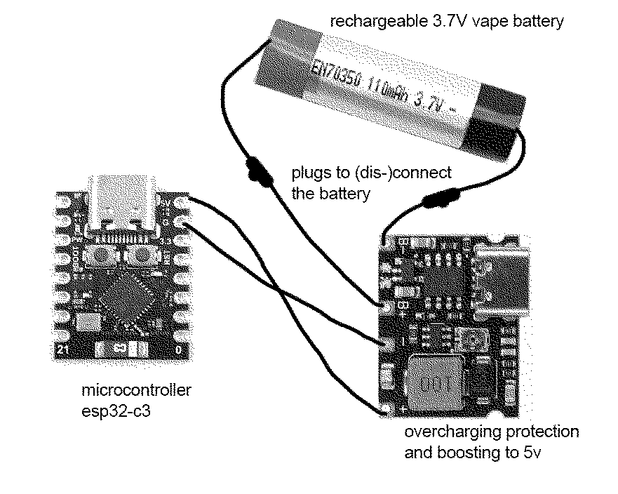
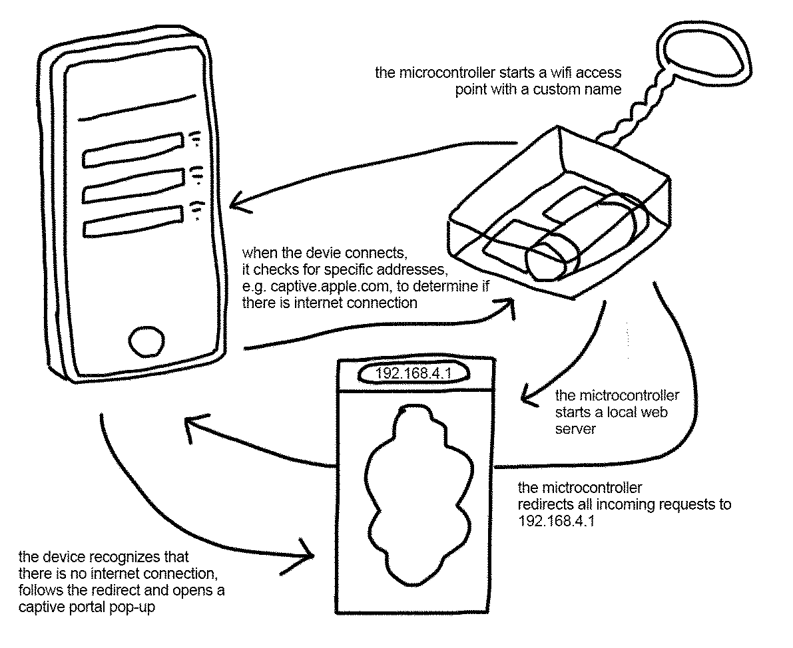

# Server Charms Workshop

This is the code and documentation of a workshop we did for the first time at the CFC25 Conference in Hamburg.
In our workshop, we create a tiny, portable microcontroller setups (Server Charms), which create their own Wi-Fi network. This network
shows up in the Wi-Fi list of nearby devices, inviting curious people to connect with their devices. Once they do, a captive portal opens, leadingto a small webpage – displaying our server charm manifesto. We are running the microcontrollers on recycled vape batteries which means that the code is optimzed for small power source.

## The Hardware



## Repository Structure

```
server-charms-workshop/
├── html-templates/
│   ├── template-guestbook.html
│   ├── template-manifesto.html
│   ├── template-blank.html
│   └── template-microlibrary.html
├── portal/
│   ├── captive-portal-guestbook.ino
│   ├── captive-portal.ino
│   └── web-content.h
├── .gitignore
├── README.md
├── captive-portal.png
└── zine_server_charm_manifesto.pdf
```

`zine_server_charm_manifesto.pdf` contains a work-in-progress documentation of how to build a server charm, our server charm manifsto as well as a small glossary. It also links to this repository. We will update the zine in the future.

`html-templates/` contains four options for server charm content: a guestbook, an interactive manifesto, an almost empty page to start from scratch, and a micro library.

Edit and preview the HTML files in a browser, then copy the chosen template into `portal/web-content.h` for use on the ESP.

`portal/captive-portal.ino` runs the Wi-Fi hotspot and captive portal with a webserver. `portal/captive-portal-guestbook.ino` is the alternative sketch with guestbook support in case you want to use the guestbook template.

Both sketches import `web-content.h` to serve the web content.

## The Code



### Changing the SSID

To change the name of the WiFi, change the `*ssid` value to a name of your choice.

### Adding Password Protection

```cpp
if (WiFi.softAP(ssid, nullptr, 6, false, maxClients))
```

To:

```cpp
if (WiFi.softAP(ssid, "your_password", 6, false, maxClients))
```

### Increasing WiFi Range

Change the transmission power from `WIFI_POWER_19_5dBm` to lower values to save power:

```cpp
WiFi.setTxPower(WIFI_POWER_11dBm);  // Maximum range
```

Available power levels: `WIFI_POWER_19_5dBm`, `WIFI_POWER_18_5dBm`, `WIFI_POWER_17dBm`, `WIFI_POWER_15dBm`, `WIFI_POWER_13dBm`, `WIFI_POWER_11dBm`, `WIFI_POWER_8_5dBm`, `WIFI_POWER_7dBm`, `WIFI_POWER_5dBm`, `WIFI_POWER_2dBm`

## Allowing More Clients

Change the `maxClients` value e.g. to

```cpp
const int maxClients = 5;  // Allow up to 5 clients
```

Note that more clients require more energy! So far, the ESP can handle around 5 clients.

## Changing the HTML content

The HTML page is included on the ESP through the `web-content.h`-file. This means ultimately, you need to add the HTML in there between

```
#ifndef HTML_CONTENT_H
#define HTML_CONTENT_H

const char index_html[] PROGMEM = R"rawliteral(
```

and

```
REPLACE_THIS_WITH_YOUR_HTML
)rawliteral";

#endif
```

It is nice to have a preview in the browser when working on the website though, which is not possible with the `.h`-file. So instead we recommend to work in a `.html` or in a text-file that you can open in the browser and only paste the code into the `web-content.h` after you are done editing. This is also why we have included our templates as `.html`-files.

For the guestbook, adding a guestbook entry only works once the code is flashed onto the ESP. This is why we have included a demonstration entry so that you can already style it. Remove it before copying the code into the `web-content.h`

### limits

This setup requires everything to be in one file. So external stylesheets, images or javascript does not work. You can use inline CSS, Javascript or e.g. inline SVGS. Note that the space on the ESP is limited – converting a complex image into an SVG can easiliy overstep that.
